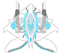
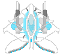
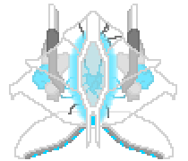

# Far From Eden: Ground Xero
**Project is still in development, some things may change later!**

   

### Readme Directory
* [Project Overview (Story/Features)](#description)
* [Manual (Installation/Controls/Menu Guide)](#manual)

## Description
#### About Far From Eden
Far From Eden is a 2D, vertically scrolling bullet hell. This personal project lets me gain hands-on experience with object-oriented programming while in school.

#### Campaign: Lockstep March Toward Damnation
Ground Xero features only the first mission titled "Ground Xero". Fight in the final war of humankind and join the march toward damnation. Featuring multiple unique enemies with various attack types and movement patterns, and a relentless boss battle waiting at the end. Witness the great societal suicide.

#### Player Ship Design

  
  

* The player ship features **see-through metal alloy**.
    * This material is vastly stronger than military-grade alloy of today.
    * The transparency makes it easier for engineers to quickly assess mechanical or biological issues with the craft.
* This craft features lab-grown biological organs that function to replace mechanical processes. 
    * These organs are grown en mass in large Organ Farms, making it faster and more efficient to mass-produce during war-time. 
    * The central 'brain' or *core*, outputs commands to other functions of the ship such as it's cannons, or multi-directional thrusters.
        * The Core also acts as a 'heart', as it pumps energy fluid to each respective function during runtime.
        * Notice the Core pumps harder when the player fires their cannons during gameplay.

#### Playground: Debugging
This is where all of the newest developments are being tested and developed. Enemies in Playground will change periodically as I am finalizing and testing different gameplay systems. This mode will not be featured in the final release.

#### Firefight: Endless Horde
While the focus of Ground Xero is the first mission alone, an endless arcade-style horde mode is also being developed for the final release of the game. Although this mode is in development, the Campaign takes higher priority.

Firefight was previously available however it has been hidden from the main menu to simplify the main menu and prioritize the Campaign, which is actively being developed.

## Manual
#### Installation and Running Far From Eden: Ground Xero
1. Install GameMaker (LTS 2026 is recommended) from gamemaker.io
2. Download/Clone this repository using `git clone https://github.com/AidanShew/ground_xero`
    - Alternatively you can simply download the repository by clicking the green Code button then downloading the zip file.
3. In the downloaded repository, open "Far From Eden Ground Xero.yyp"
4. Once the project opens, press F5 (Or click the play button at the top) to launch the game.
###### **Installation Disclaimer** 
- This project was mostly tested on Windows 11 and macOS, however this project may not behave as intended on other operating systems.
- An executable file for this project is not available at this time, to play this game, please follow the installation instructions above.

#### Controls
###### Movement
- 'W': Move up
- 'A': Move left
- 'S': Move down
- 'D': Move right
###### Combat
- 'Up Arrow Key': Shoot bullets
- 'Down Arrow Key': Change color polarity (Red/Blue)
###### General
- 'Esc': Pause the game

#### Main Menu
- ***Campaign*** is the main mode of the game.
- ***Playground*** is the debugging room where new mechanics are tested and designed. This will not be featured in the final release. To access Playground, press F1 on the main menu.

#### Exiting the Game
"Exit to Desktop" button will close the game and return to GameMaker.
    - You can find this button on the main menu or by pressing the "Esc" key at any point during gameplay.